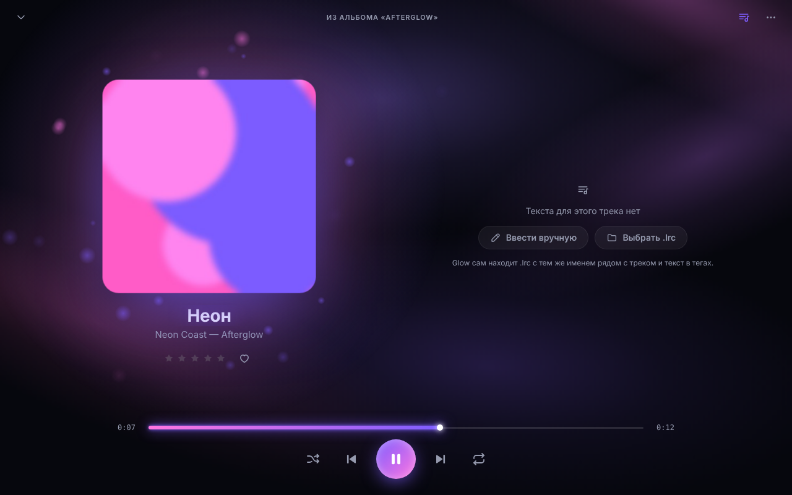
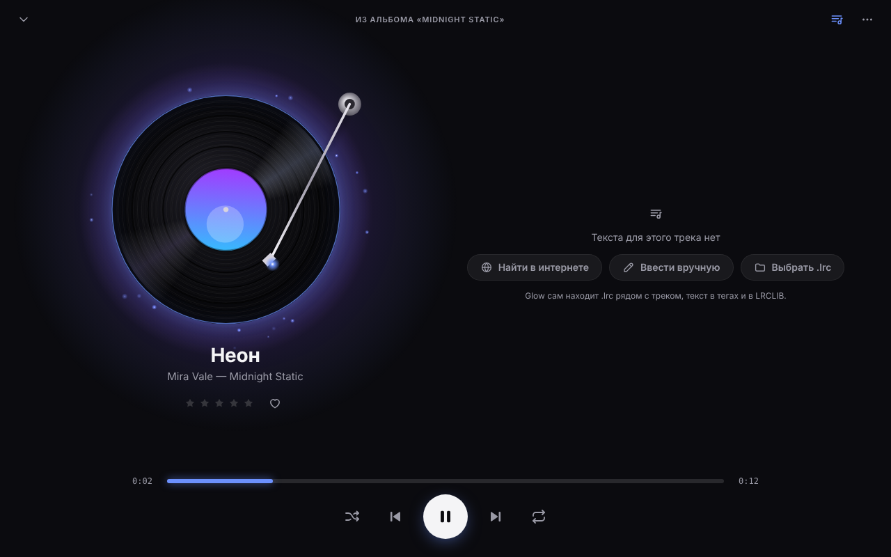
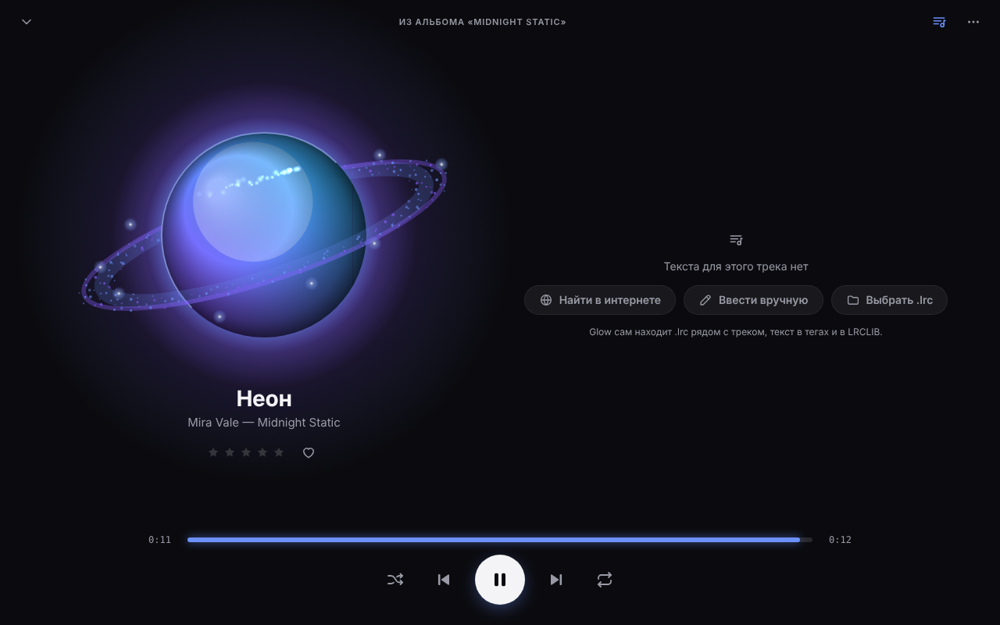
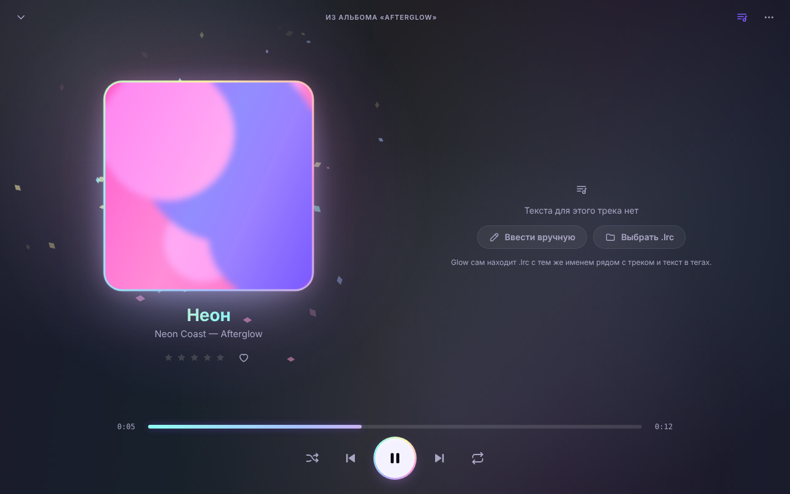
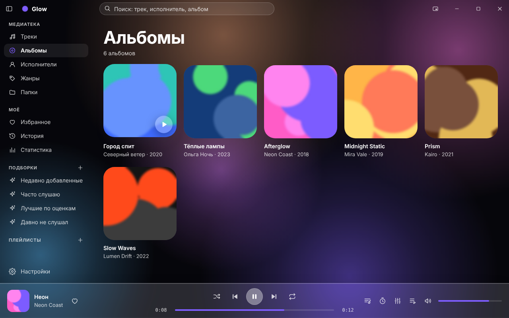
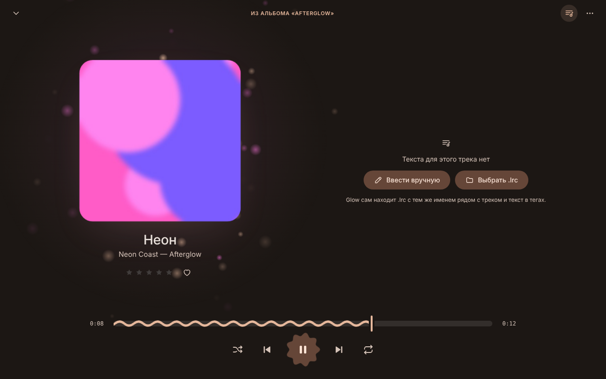
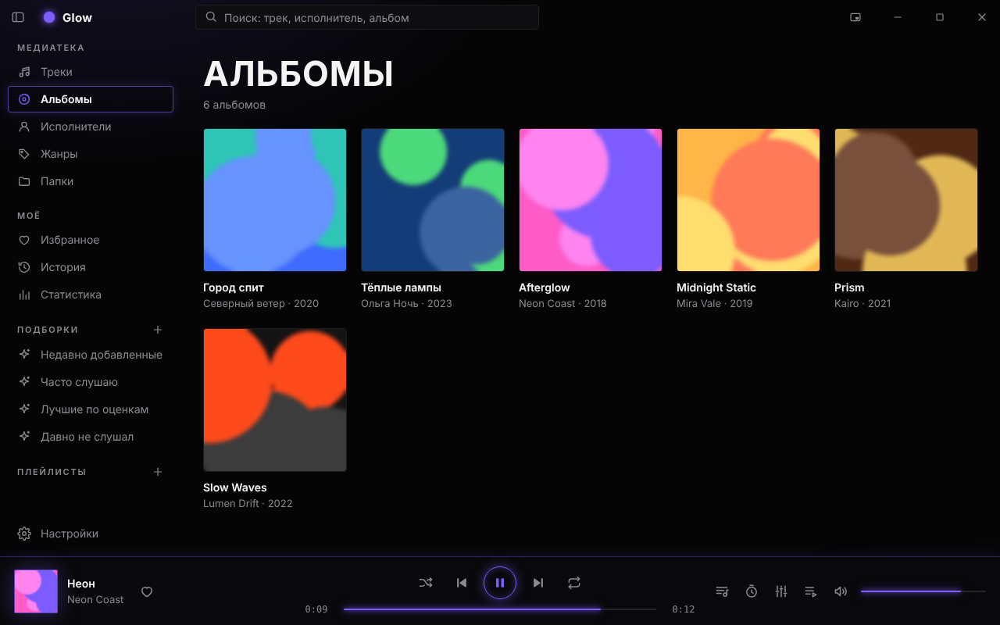

<div align="center">

# Glow

**Музыкальный плеер для Windows, который светится цветом обложки.**
28 стилей — от Liquid Glass и Material 3 до голографического, свой редактор стилей, эквалайзер, ReplayGain, тексты песен и умные подборки. Без аккаунтов, рекламы и облака: только твоя музыка с диска.

[Скачать для Windows](../../releases/latest) · [Что умеет](docs/GUIDE.md) · [Планы](docs/ROADMAP.md) · [English](#english)



</div>

## Почему Glow

Плееры для ПК обычно либо мощные, но выглядят как в 2005-м (foobar2000, AIMP), либо красивые, но умеют только стриминг. Glow — локальный плеер для своей коллекции, где интерфейс подстраивается под каждый альбом: цвета, свечение и фон берутся из обложки.

<table>
<tr>
<td></td>
<td></td>
</tr>
<tr>
<td align="center">Сцена «Светящийся винил» (Dark Premium)</td>
<td align="center">Сцена «Светящаяся планета» (Deep Space)</td>
</tr>
<tr>
<td></td>
<td></td>
</tr>
<tr>
<td align="center">Holographic</td>
<td align="center">Liquid Glass</td>
</tr>
<tr>
<td></td>
<td></td>
</tr>
<tr>
<td align="center">Material 3 / Material You</td>
<td align="center">Neo-Noir</td>
</tr>
</table>

## Возможности

**Вид**
- 28 стилей: Aurora, Neo-Noir, Deep Space, Nordic, Fluent, Paper, Studio, Holographic, Liquid Glass, Material Glass и 8 тем Material 3 с динамическим цветом от обложки.
- Material 3 по-настоящему: волнистый прогресс, кнопка Play меняет форму, 5 вариантов схемы, светлые темы и режим «как в Windows».
- Сцены экрана плеера вместо обложки: светящийся винил, кассета, светодиодная матрица, жидкий свет, светящаяся планета.
- Живые детали у каждого стиля: лучи у Aura, снег у Nordic, угли у Copper, светлячки у Soft Dark, иней у Midnight Blue, затмение у Obsidian.
- Редактор своего стиля: слои, пресеты, история версий, экспорт в `.glowtheme`.
- Экран воспроизведения с частицами и вспышками в такт музыке, синхронные тексты.

**Звук**
- FLAC, MP3, OGG, Opus, AAC/M4A, WAV.
- Переход без пауз и кроссфейд, 10-полосный эквалайзер с 11 пресетами.
- ReplayGain из тегов, а для файлов без тегов Glow сам измеряет громкость (EBU R128).

**Медиатека**
- Альбомы, исполнители, жанры, папки, плейлисты, избранное, оценки, история и статистика.
- Подборки по правилам: «жанр — Lo-fi, год после 2020, оценка от 4».
- Новые файлы в папках появляются сами. Переехавшие треки находятся без потери плейлистов.
- Плейлисты `.m3u` из других плееров, перетаскивание файлов и папок прямо в окно.
- Поиск дубликатов: Glow покажет, какая копия лучше по качеству, и аккуратно уберёт лишние.
- «Итоги года»: минуты музыки, треки, исполнители и альбомы года, серии и любимое время суток.

**Онлайн — по желанию**
- Синхронные тексты из LRCLIB и обложки из iTunes и MusicBrainz — найденное сохраняется, дальше работает без сети.
- Скробблинг в Last.fm и ListenBrainz: прослушивания копятся офлайн и уходят, когда появится интернет.
- Статус «Слушает» в Discord с обложкой альбома.
- Режим «Без интернета» — Glow не выходит в сеть совсем.
- Редактор тегов и обложек, которые видят и Проводник, и другие плееры.

**Язык** — русский и английский интерфейс.

**Windows**
- Трей, кнопки на миниатюре в панели задач, медиаклавиши и системная панель с обложкой.
- Глобальные горячие клавиши, мини-плеер поверх окон.
- Автообновление: новые версии ставятся в один клик.
- Настройки по вкладкам и поиск по ним.

Полный список — в [руководстве](docs/GUIDE.md).

## Скоро

- **2.0 — Glow как экосистема:** ПК и телефон — одна медиатека с передачей музыки по Wi-Fi, звуковое ядро на Rust со всеми форматами и настоящим «без пауз».

Подробнее — в [планах](docs/ROADMAP.md).

## Установка

Скачай `Glow_x.y.z_x64-setup.exe` со страницы [Releases](../../releases/latest) и запусти. Нужна Windows 10 или 11.

> Установщик пока не подписан сертификатом, поэтому Windows SmartScreen может предупредить. Нажми «Подробнее» → «Выполнить в любом случае».

Настройки, плейлисты и стили лежат в `%APPDATA%\Glow` и не стираются при обновлении.

## Сборка из исходников

Нужны [Rust](https://rustup.rs), [Node.js](https://nodejs.org) LTS и [Visual Studio Build Tools](https://visualstudio.microsoft.com/visual-cpp-build-tools/) с компонентом «Разработка классических приложений на C++».

```bash
npm install
npm run dev      # запуск с перезагрузкой интерфейса
npm run build    # установщик в src-tauri/target/release/bundle/nsis/
```

### Тесты

```bash
npm test                       # юнит-тесты: тексты, палитры, стили, версии
npx playwright install chromium   # один раз
npm run test:e2e               # интерфейс в настоящем браузере, скриншоты в tests/e2e/shots
```

Тесты запускаются на GitHub при каждом push. Как выпустить новую версию — в [docs/RELEASING.md](docs/RELEASING.md).

### Устройство

```
src/                интерфейс: HTML, CSS, JavaScript без сборщика
  js/main.js        запуск и связывание модулей
  js/state.js       настройки, медиатека, хранилище
  js/views.js       разделы: треки, альбомы, исполнители…
  js/player.js      воспроизведение, очередь, экран плеера
  js/audio.js       звуковой движок: Web Audio, эквалайзер, ReplayGain, кроссфейд
  js/theme.js       стили и палитры Material 3
  js/editor.js      редактор своего стиля
  …                 sidebar, settings, dialogs, handlers, features, smart, updates
src-tauri/          Rust (Tauri 2)
  src/lib.rs        сканер, теги (lofty), протокол stream://, хранилище, обновления
  src/desktop.rs    трей, горячие клавиши, панель задач, слежение за папками
tests/              юнит- и сквозные тесты
```

Glow — часть экосистемы: есть версия для Android (Kotlin, Jetpack Compose, Media3), плейлисты и оценки переносятся между ними через файл `.glowsync`.

---

## English

**Glow is a local music player for Windows that glows with the colors of the album art.** 28 themes (Liquid Glass, Material 3 with dynamic color, Holographic, Neo-Noir…), a custom theme editor, gapless playback and crossfade, a 10-band EQ, ReplayGain with built-in loudness analysis, synced lyrics, rule-based smart playlists, automatic library updates, tray and taskbar controls, global hotkeys and one-click updates. No accounts, no ads, no cloud — just your own music.

Player-screen scenes replace the cover with a glowing vinyl record, a cassette, an LED matrix, liquid light or a glowing planet. The interface is available in English and Russian (Settings → Look → Language). Online extras: synced lyrics from LRCLIB, cover search, Last.fm and ListenBrainz scrobbling, Discord status.

Built with Tauri 2 and Rust; the UI is plain HTML/CSS/JS. Coming in 2.0: one shared library between the PC and Android apps over Wi-Fi and a Rust audio engine. See the [roadmap](docs/ROADMAP.md).

Download the installer from [Releases](../../releases/latest). To build from source: `npm install && npm run build`.
